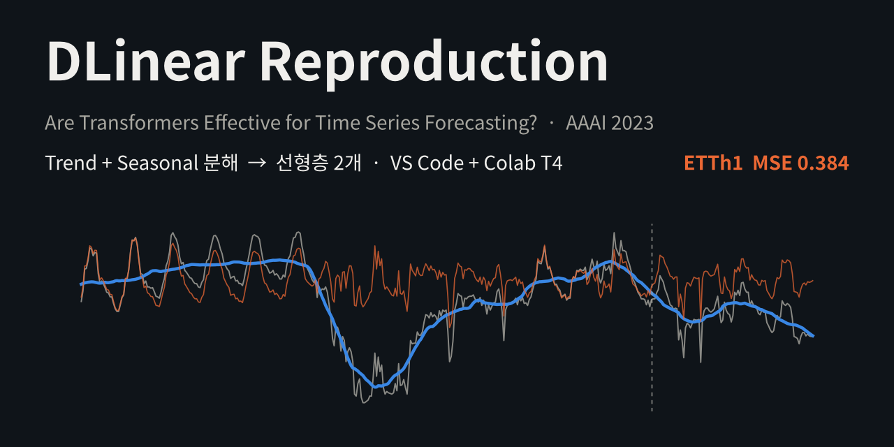
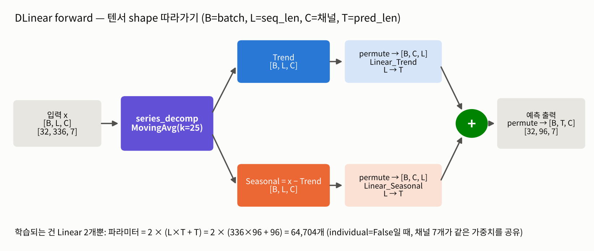
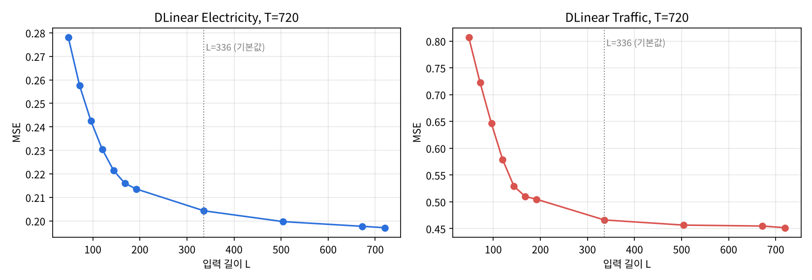

# DLinear 재현 (VS Code + Google Colab)

논문 **Are Transformers Effective for Time Series Forecasting?** (Zeng et al., AAAI 2023)의 DLinear 결과(Table 2, 다변량)를
공식 코드 [cure-lab/LTSF-Linear](https://github.com/cure-lab/LTSF-Linear)로 재현한 기록.

- 논문: <https://arxiv.org/abs/2205.13504>
- 실행 환경: VS Code + Google Colab 확장(`google.colab`), Colab T4 GPU
- 공식 코드는 이 레포에 복사하지 않고, 노트북이 실행 시점에 clone한다.





## 폴더 구성

| 경로 | 내용 |
|---|---|
| `DLinear_reproduce.ipynb` | 재현 노트북 (코드 받기 → 패치 → 데이터 → 실험 → 결과 비교 → 시각화) |
| `DLinear_extra_experiments.ipynb` | 추가 실험: 시드 편차, 단변량(Table 9), 가중치 그림(Figure 7), `--individual`, 입력 길이(Figure 4) |
| `results/extra_experiments.md` | 추가 실험 결과와 해석 |
| `scripts/lab.py` | 추가 실험 노트북이 쓰는 도우미 (공식 스크립트에서 명령을 뽑아 실행·재개·집계) |
| `.vscode/` | 권장 확장(Colab, Jupyter)과 노트북 설정 |
| `scripts/dlinear_check.py` | 공식 설정을 그대로 옮긴 독립 DLinear 재구현 (ETTh1, CPU로도 실행 가능) |
| `scripts/make_figs.py` | 설명용 그림 14장 생성 |
| `scripts/weights_fig.py` | 학습된 DLinear 가중치 시각화 |
| `figures/` | 생성된 그림 |
| `results/` | 재현 결과 (`result.txt`, 비교표) |

## 실행 방법

### VS Code (권장)
1. 레포를 clone해서 폴더를 VS Code로 연다 → "권장 확장 설치" 알림에서 **설치** (Colab + Jupyter).
2. `DLinear_reproduce.ipynb` 열기 → 오른쪽 위 **Select Kernel → Colab → New Colab Server → GPU → T4 → High-RAM**.
   - Electricity·Traffic은 test 단계에서 메모리를 많이 써서 Standard(12.7GB)로는 강제 종료된다. ETT 등 작은 데이터만 돌릴 거면 Standard도 된다.
   - 처음엔 구글 로그인이 필요하다. 로그인 대기 시간이 1분이라, 브라우저에서 바로 계정 선택 → 허용.
3. 위에서부터 셀 실행.

### 브라우저 Colab
노트북을 Colab에 업로드 → 런타임 유형 GPU → 위에서부터 실행.

## 최신 환경에서 필요한 패치

공식 `requirements.txt`는 `torch==1.9` / Python 3.6 기준이라 **설치하지 않는다** (Colab 기본 환경 사용).
NumPy 2.x에서는 `np.Inf`가 삭제돼 학습 시작 직후 에러가 나므로 한 줄 고친다.

```bash
sed -i 's/np\.Inf/np.inf/' utils/tools.py
```

## 결과

공식 스크립트 그대로(seed 2021, `--itr 1`, Colab T4) 논문 Table 2의 9개 데이터셋 × horizon 4개, 총 36칸을 모두 돌렸다. MSE 기준:

- **논문과 거의 일치 (|차이| ≤ 0.015)**: 36칸 중 26칸. ETTm1·Weather·Electricity·Traffic은 전 구간이 일치한다 (Electricity·Traffic은 |차이| ≤ 0.003).
- **조금 벗어남 (0.02~0.04)**: 4칸 (ETTh1 192·720, ETTm2 720, Exchange 336)
- **크게 벗어남 (> 0.05)**: 6칸 (ETTh2 720, Exchange 720, ILI 전 구간). 작은 데이터셋이거나 가장 긴 horizon이다.
- Electricity·Traffic은 Standard RAM(12.7GB)에서 test 단계 메모리 부족으로 강제 종료돼서 High-RAM 런타임(51GB)으로 다시 돌렸다.

표 전체와 원인 분석: [`results/README.md`](results/README.md) · 원자료: [`results/dlinear_multivariate.csv`](results/dlinear_multivariate.csv)

### 추가 실험 (DLinear만): [`results/extra_experiments.md`](results/extra_experiments.md)
- **시드 편차:** 벗어난 10칸 중 4칸(ETTh1 192·720, ETTm2 720, Exchange 336)은 3번 중 한 번이 논문과 0.012 이내다. 시드로 설명된다.
- **평가 코드 변경:** 공식 레포가 논문 이후(2023-03-15, `6fe4c28`) test DataLoader의 `drop_last`를 `True`에서 `False`로 바꿨다. 논문 당시 코드로 평가하면 ILI T=36·48·60이 논문 쪽으로 크게 움직인다(차이 +0.29 → +0.13, +0.19 → +0.05, +0.11 → +0.02).
- **아직 설명 안 됨:** ETTh2 720과 Exchange 720(시드 표준편차 0.12).
- **나머지 실험:** 단변량(Table 9)은 16칸 중 12칸이 ±0.005 이내다. 가중치 그림에서는 24·168·336시간 주기가 보인다. 입력 길이를 48에서 720으로 늘리면 MSE가 단조롭게 감소한다. `--individual`은 데이터에 따라 득실이 갈린다.



### 주의: 시드 편차
학습률이 매 epoch 절반으로 줄고 patience 3이라 몇 epoch 안에 early stop되므로, 작은 데이터셋(ETTh1 등)은 시드에 따라 결과가 꽤 흔들린다.
독립 재구현(`scripts/dlinear_check.py`)으로 확인한 ETTh1 MSE:

| horizon | 논문 | seed 2021 | seed 1 | seed 2 | seed 3 |
|---|---|---|---|---|---|
| T=96 | 0.375 | 0.384 | 0.372 | 0.375 | – |
| T=336 | 0.439 | 0.508 | 0.442 | 0.447 | 0.458 |

공식 코드는 seed 2021로 고정돼 있어서 같은 설정을 다시 돌리면 결과가 똑같이 나온다 (ETTh1 96을 두 번 돌려 둘 다 0.38414). 반면 시드를 바꾸면 위처럼 흔들리므로, 한 번 결과로 판단하지 말고 `--itr 3` 평균으로 볼 것.
같은 seed 2021이어도 공식 코드(ETTh1 336: 0.447)와 독립 재구현(0.508)의 값이 다른 이유는, 데이터 로더 셔플 등 난수를 쓰는 순서가 달라서다.

## 그림 다시 만들기

```bash
pip install numpy pandas matplotlib torch
python scripts/make_figs.py path/to/ETTh1.csv figures
python scripts/dlinear_check.py path/to/ETTh1.csv 96 1 viz   # w_seasonal.npy, w_trend.npy 저장
python scripts/weights_fig.py . figures
```

한글 폰트(Noto Sans CJK KR)가 설치돼 있어야 그림 속 한글이 제대로 나온다.

## 출처
- 공식 코드: [cure-lab/LTSF-Linear](https://github.com/cure-lab/LTSF-Linear) (Apache-2.0)
- 데이터: ETT는 [zhouhaoyi/ETDataset](https://github.com/zhouhaoyi/ETDataset), 나머지는 Autoformer 저자 제공 구글 드라이브
