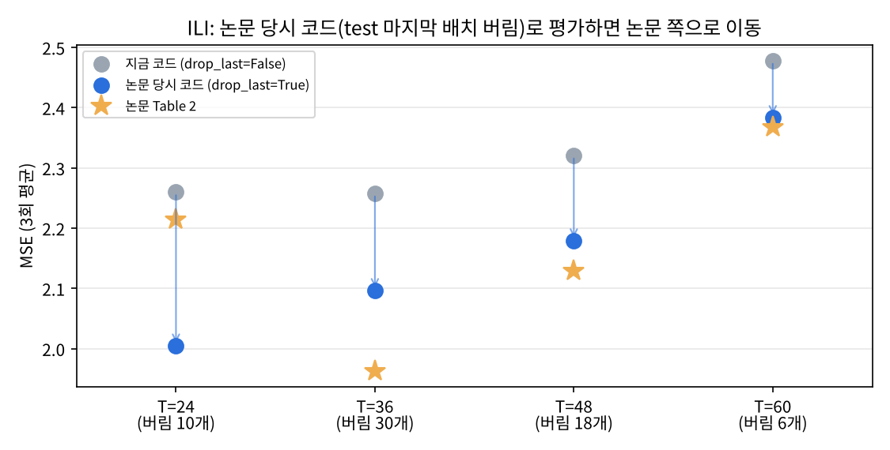
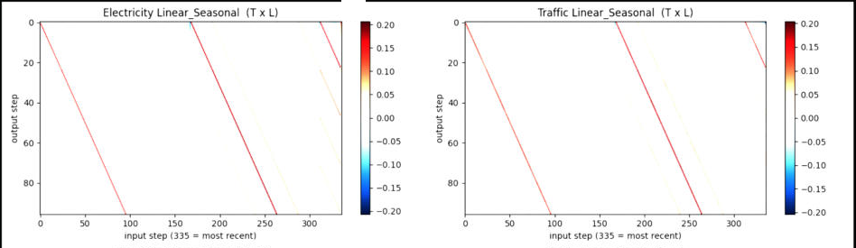
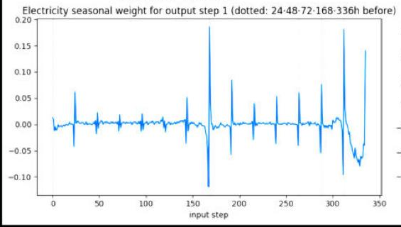
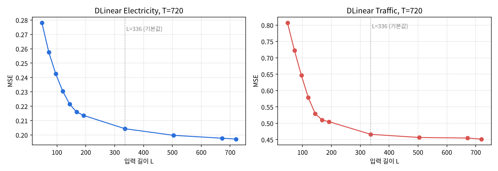

# DLinear 추가 실험 결과

[`DLinear_extra_experiments.ipynb`](../DLinear_extra_experiments.ipynb)로 2026-11-04~05에 Colab T4 High-RAM에서 돌린 결과.
하이퍼파라미터는 모두 공식 스크립트 값 그대로이고, 지표는 정규화 스케일 MSE다. 원자료는 같은 폴더의 `extra_*.csv`.

## 1. 시드 편차 + test `drop_last` 가설 (Table 2에서 벗어난 10칸)

공식 레포 이력을 보면 커밋 [`6fe4c28`](https://github.com/cure-lab/LTSF-Linear/commit/6fe4c28) (2023-03-15, 논문 발표 이후)에서
`data_provider/data_factory.py`의 **test DataLoader `drop_last`가 `True` → `False`** 로 바뀌었다.
이틀 뒤 커밋 `932c61d`에서 `np.array(preds).reshape(...)`가 `np.concatenate(preds)`로 바뀐 것도 같은 맥락이다. 마지막 배치 크기가 달라져서 필요해진 수정이다.
즉 논문 숫자는 **test 셋의 마지막 덜 찬 배치를 버리고** 계산했을 가능성이 크다. 버려지는 샘플은 test 구간의 맨 끝(가장 최근)이다.

같은 10칸을 `--itr 3`으로 두 가지 코드에서 돌렸다. 학습은 같고(run마다 같은 모델), test 평가만 다르다.

| 칸 | run0 / run1 / run2 (지금 코드) | 평균 ± 표준편차 | 3번 중 최고 − 논문 | 버린 샘플 | 평균 (논문 당시 코드) | 논문 | 차이: 지금 → 당시 |
|---|---|---|---|---|---|---|---|
| ETTh1 192 | 0.443 / 0.430 / 0.411 | 0.428 ± 0.016 | **+0.006** | 2689 중 1 | 0.428 | 0.405 | +0.023 → +0.023 |
| ETTh1 720 | 0.504 / 0.475 / 0.535 | 0.505 ± 0.030 | **+0.003** | 2161 중 17 | 0.504 | 0.472 | +0.033 → +0.032 |
| ETTm2 720 | 0.427 / 0.409 / 0.431 | 0.422 ± 0.011 | +0.012 | 10801 중 17 | 0.422 | 0.397 | +0.025 → +0.025 |
| Exchange 336 | 0.333 / 0.316 / 0.350 | 0.333 ± 0.017 | +0.011 | 1182 중 30 | 0.328 | 0.305 | +0.028 → +0.023 |
| ETTh2 720 | 0.733 / 0.660 / 0.709 | 0.700 ± 0.037 | +0.055 | 2161 중 17 | 0.699 | 0.605 | +0.095 → +0.094 |
| Exchange 720 | 0.898 / 1.072 / 0.841 | 0.937 ± **0.120** | +0.198 | 798 중 30 | 0.938 | 0.643 | +0.294 → +0.295 |
| ILI 24 | 2.280 / 2.240 / 2.261 | 2.260 ± 0.020 | +0.025 | 170 중 10 | **2.005** | 2.215 | +0.045 → −0.210 |
| ILI 36 | 2.235 / 2.267 / 2.272 | 2.258 ± 0.020 | +0.272 | 158 중 30 | **2.096** | 1.963 | +0.295 → **+0.133** |
| ILI 48 | 2.298 / 2.345 / 2.320 | 2.321 ± 0.023 | +0.168 | 146 중 18 | **2.179** | 2.130 | +0.191 → **+0.049** |
| ILI 60 | 2.573 / 2.430 / 2.431 | 2.478 ± 0.082 | +0.062 | 134 중 6 | **2.384** | 2.368 | +0.110 → **+0.016** |

**해석**
- **시드로 설명되는 칸 (ETTh1 192·720, ETTm2 720, Exchange 336):** 3번 중 한 번은 논문과 0.012 이내다. 학습률이 매 epoch 절반으로 줄고 patience가 3이라 몇 epoch 만에 끝나서 run마다 흔들린다.
- **평가 코드 차이로 대부분 설명되는 칸 (ILI):** 시드 표준편차는 0.02인데 논문과는 0.3까지 벌어져 있었다. 논문 당시 코드로 평가하자 T=36·48·60이 논문 쪽으로 크게 움직였고, T=60은 사실상 일치한다. T=24는 반대로 논문보다 낮아져서 drop_last가 유일한 원인은 아니다. ILI test 셋이 134~170개로 아주 작아서 마지막 몇 샘플이 MSE를 크게 좌우한다.
- **아직 설명되지 않는 칸 (ETTh2 720, Exchange 720):** drop_last를 바꿔도 거의 그대로다. 시드 편차가 크고(특히 Exchange 720 ± 0.12), 가장 좋은 run도 논문과 0.055~0.2 차이가 난다. 남은 후보는 하드웨어나 PyTorch 버전 차이, 그리고 논문이 여러 run 중 하나를 보고했을 가능성이다.

## 2. 단변량 (논문 Table 9, `univariate/*.sh`)

| 데이터 | T=96 | T=192 | T=336 | T=720 |
|---|---|---|---|---|
| ETTh1 | 0.056 (0.056) | 0.075 (0.071) | 0.091 (0.098) | 0.168 (0.189) |
| ETTh2 | 0.131 (0.131) | 0.175 (0.176) | 0.211 (0.209) | 0.295 (0.276) |
| ETTm1 | 0.027 (0.028) | 0.043 (0.045) | 0.060 (0.061) | 0.081 (0.080) |
| ETTm2 | 0.064 (0.063) | 0.092 (0.092) | 0.129 (0.119) | 0.172 (0.175) |

괄호 = 논문. 16칸 중 12칸이 ±0.005 이내다. 논문 값은 PDF 추출로 옮겼으니 원문 표와 한 번 더 대조할 것.

## 3. 가중치 그림 (논문 Figure 7)

$1/L$ 초기화(주석 처리된 두 줄을 살림)로 L=336 → T=96을 학습했다. MSE는 Electricity 0.140, Traffic 0.413로 기본 초기화와 같다.

- Seasonal 가중치에 **168시간(1주)·336시간(2주) 전**을 가리키는 강한 대각선이 생기고, 24시간 간격의 약한 선도 있다.
- Electricity의 "다음 1시간" 가중치는 24시간 간격으로 튀고, 1주 전과 2주 전 지점이 가장 크다. 모델이 **같은 요일·같은 시각**의 과거 값을 가장 많이 참고한다는 뜻이다.
- 그림은 노트북 출력 화면을 캡처한 것이다.

## 4. `--individual` (채널마다 W 따로)

DLinear 스크립트에 `--individual`만 붙였다. Electricity·Traffic은 채널이 많아 너무 느려서 제외했다.

| 데이터 | individual (96 / 192 / 336 / 720) | 공유 W (첫 재현) |
|---|---|---|
| Weather | **0.148 / 0.191 / 0.243 / 0.320** | 0.174 / 0.218 / 0.263 / 0.332 |
| ETTh1 | 0.378 / 0.421 / 0.447 / 0.487 | 0.384 / 0.443 / 0.447 / 0.504 |
| ETTm1 | 0.288 / 0.330 / 0.368 / 0.428 | 0.301 / 0.336 / 0.372 / 0.427 |
| ILI (24~60) | 2.187 / 2.220 / 2.318 / 2.492 | 2.280 / 2.235 / 2.298 / 2.573 |
| Exchange | 0.089 / 0.173 / 0.337 / 0.993 | 0.085 / 0.162 / 0.333 / 0.898 |
| ETTh2 | 0.408 / 0.575 / 0.647 / **1.077** | 0.290 / 0.388 / 0.463 / 0.733 |
| ETTm2 | 0.194 / 0.337 / 0.488 / **0.801** | 0.172 / 0.237 / 0.295 / 0.427 |

- 결론은 "공유가 항상 낫다"도 "개별이 항상 낫다"도 아니다. Weather는 4칸 모두 개별이 낫고, ETTh2·ETTm2는 크게 나빠진다.
- 나빠지는 두 데이터는 스크립트 학습률이 0.05, 0.01로 큰 경우다. 채널마다 따로 둔 $W$가 과적합하는 것으로 보인다. 같은 학습률을 그대로 쓴 비교라서, individual에 맞게 학습률을 다시 튜닝하면 결과가 달라질 수 있다.

## 5. 입력 길이 (논문 Figure 4, `Linear_DiffWindow.sh`, T=720)

| L | 48 | 72 | 96 | 120 | 144 | 168 | 192 | 336 | 504 | 672 | 720 |
|---|---|---|---|---|---|---|---|---|---|---|---|
| Electricity | 0.278 | 0.258 | 0.243 | 0.231 | 0.222 | 0.216 | 0.214 | 0.204 | 0.200 | 0.198 | 0.197 |
| Traffic | 0.807 | 0.722 | 0.646 | 0.579 | 0.529 | 0.510 | 0.505 | 0.466 | 0.457 | 0.455 | 0.452 |

- L이 길수록 MSE가 단조롭게 줄어든다. "선형 모델은 입력이 길수록 좋아진다"는 논문 주장과 같다. Traffic은 L=48에서 336으로 가면서 0.81 → 0.47로 거의 절반이 됐다.
- 336 이후로는 개선 폭이 작다. 336→720에서 Electricity는 −0.007, Traffic은 −0.015다.
- L=336 값(0.204 / 0.466)은 Table 2 재현값과 같다.

## 실행 메모
- 시간: 실험 1·1-2 각 11분, 단변량 28분, 가중치 10분, individual 72분, 입력 길이 약 5시간 (T4).
- 첫 실행 중 PC가 배터리 모드 30분 절전에 들어가면서 서버가 사라졌다. 긴 실험은 **충전기를 꽂고, 화면 끄기·절전을 모두 "안 함"으로** 해야 한다.
- 노트북의 메모리 절약 패치(`inputx` 미수집)는 지표 계산과 무관하다.
